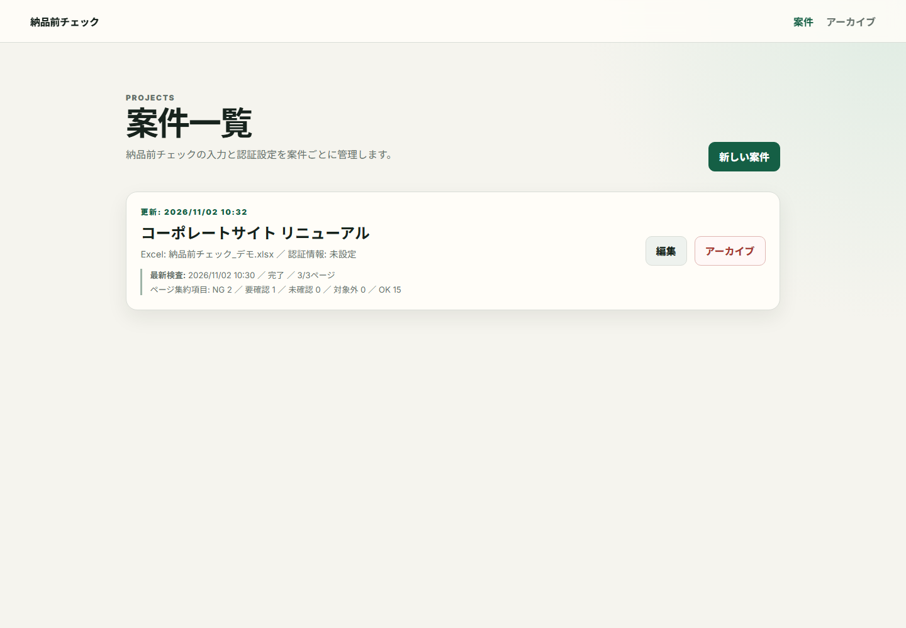
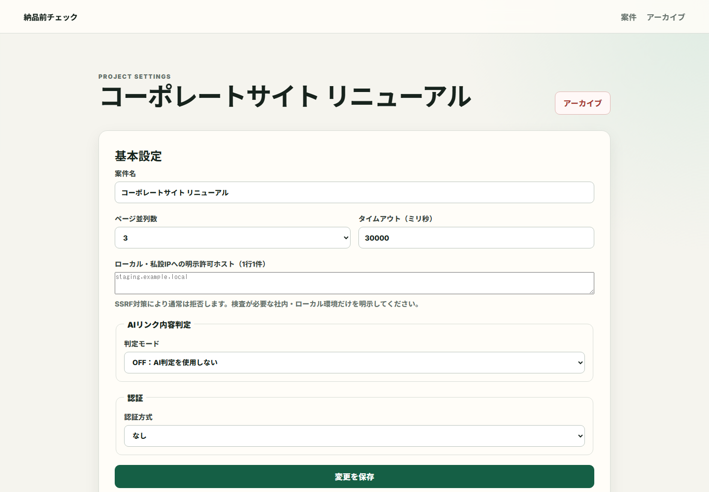
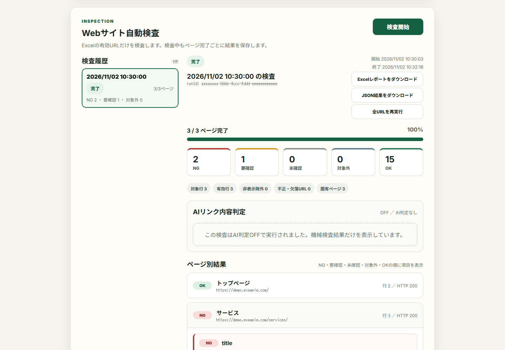
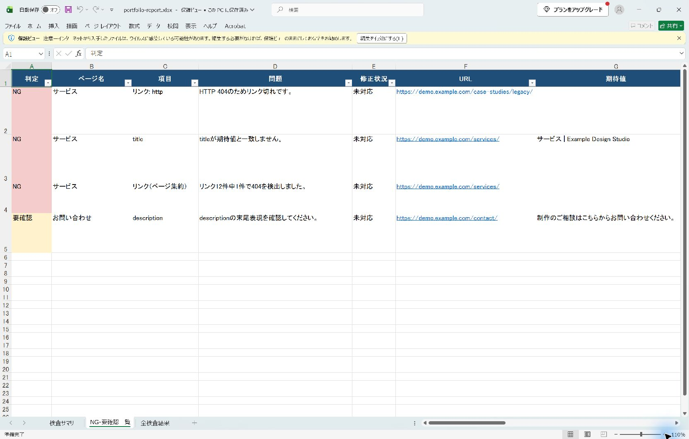

# Webサイト納品前チェックツール

Web制作の納品前確認を、自動化・一元管理するNuxt 3製のローカルWebアプリです。

Excelで管理している確認項目を取り込み、Webサイトを実際に巡回して、メタ情報・Googleタグ・リンク・画像を検査します。案件ごとの進捗や過去の結果を画面で確認でき、関係者へ共有しやすいExcelレポートも出力できます。

制作会社やWeb担当者が行う「複数ページを開く」「期待値と見比べる」「結果を転記する」といった反復作業を減らし、確認漏れの防止と検査品質の標準化を支援します。

## できること

- **案件と検査履歴を一元管理** — 案件ごとの設定、入力Excel、実行結果、過去履歴をまとめて確認
- **Webサイトを自動検査** — PlaywrightでJavaScript描画後のページを取得し、title・description、Googleタグ、リンク、PC・スマートフォン画像を判定
- **期待値と実測値を比較** — Excelから読み込んだ期待値と、サイト上の実測値・判定根拠をページ単位で表示
- **結果をレポート化** — サマリー、NG・要確認一覧、全検査結果を含むExcelレポートを出力
- **再検査と差分確認** — 全URLの再実行と、過去2回の検査結果の比較に対応
- **安全なローカル運用** — 認証情報の暗号化、CSRF対策、アクセス先制限、共有用JSONの秘密情報マスキングを実装
- **必要に応じてAI判定を追加** — リンク先の内容確認を手動連携またはOpenAI APIで補助

## 画面イメージ

以下はすべて、公開用に作成したダミーデータを使用しています。

<table>
  <tr>
    <td width="50%">
      <strong>案件一覧</strong> 
      
    </td>
    <td width="50%">
      <strong>案件詳細・検査設定</strong> 
      
    </td>
  </tr>
  <tr>
    <td width="50%">
      <strong>検査結果</strong> 
      
    </td>
    <td width="50%">
      <strong>Excelレポート</strong> 
      
    </td>
  </tr>
</table>

## 基本的な利用の流れ

1. 案件を登録し、検査条件を設定する
2. 指定形式のExcelファイルをアップロードする
3. Webサイトの検査を実行する
4. 画面でNG・要確認項目と判定根拠を確認する
5. Excelレポートを出力し、修正・確認作業に利用する

## 技術的な見どころ

- Nuxt 3 / Vue 3 / TypeScriptによるフロントエンド・サーバーAPIの一体構成
- Playwrightを使ったJavaScript描画後DOMの検査
- Vitestによる入力処理、検査ロジック、セキュリティ、レポート出力の自動テスト
- 原子的なファイル保存と途中結果の記録による、キャンセル・異常終了からの安全な復旧
- SSRF、秘密情報の保存・出力、過大ファイルなど、ローカルツールでも必要になるセキュリティへの対応

本ツールはWindows 11上での個人利用を想定しています。基本操作を短く確認したい場合は[簡易操作マニュアル](docs/簡易操作マニュアル.md)、詳しい判定基準・エラー・データ管理まで確認したい場合は[操作マニュアル](docs/操作マニュアル.md)を参照してください。

## 必要環境

- Node.js 20以降
- npm

## セットアップ

1. `npm install`
2. `npm run playwright:install`
3. `.env.example` を `.env` へコピー
4. `APP_ENCRYPTION_KEY` に32バイト鍵をBase64または64桁の16進数で設定
5. `npm run dev`
6. `http://127.0.0.1:3000` を開く

鍵はPowerShellで `[Convert]::ToBase64String([Security.Cryptography.RandomNumberGenerator]::GetBytes(32))` を実行して生成できます。鍵を失うと保存済み認証情報は復号できません。

## コマンド

- `npm run dev`: 127.0.0.1限定で開発起動
- `npm run build`: 本番ビルド
- `npm run start`: ビルド済みサーバーを127.0.0.1限定で起動
- `npm run typecheck`: TypeScript検査
- `npm test`: 単体テスト
- `npm run playwright:install`: 検査用Chromiumをインストール

## データ管理

案件は `DATA_DIR`（初期値 `./data`）の `projects/<UUID>/` に保存します。Excel原本は変更せず、`input/current.xlsx` にコピーします。Basic認証情報は `APP_ENCRYPTION_KEY` を使ったAES-256-GCMで `secrets.enc.json` に分離保存します。検査結果は `runs/<runId>/` の `input-snapshot.json`、`result.json`、`events.jsonl` へ保存し、ページ完了ごとに `result.json` を更新します。

`data/`、`.env`、生成物、認証状態はGit対象外です。認証方式は「なし」「Basic認証」「パスワード保護」です。パスワード保護はWordPressの「Password Protected」プラグインが出力するサイト全体の保護フォームを対象とし、パスワードを案件別の `password-protected.secret.json` へ平文で保存します。このファイルはAPI応答や検査結果には含めず、別の認証方式へ変更したときに削除します。DATA_DIRは現在の利用者だけが読み取れる場所に置いてください。旧フォーム認証案件は読み取り互換のため保持しますが、検査前に認証方式の再設定が必要です。保存済みの旧認証情報を自動削除・変換しません。案件削除機能はありません。アーカイブは `project.json` の日時だけを変更し、Excelや履歴を移動・削除しません。

URL同一性を秘密値を含めず照合するため、用途分離されたHMAC-SHA-256鍵を `DATA_DIR/.url-identity-key` に保存します。AI入力署名用の `.ai-signing-key` とは共用しません。初回起動時だけ初期化し、初期化済みマーカーがある状態で鍵が欠落した場合は再生成せず安全に停止します。鍵と `.url-identity-key.initialized` はDATA_DIRのバックアップへ必ず含めてください。Windowsではファイルモードだけに依存せず、DATA_DIRを現在の利用者だけが読み取れる場所に置いてください。

URLの表示用マスキングは、既知のuserinfoおよび `token`、`key`、`secret`、`auth`、`password`、`session`、`sid`、`cookie`、`api_key`、`access_token`、`refresh_token` と一般的な表記揺れを対象にします。新規runでは元URLを実行中のメモリだけで扱い、入力スナップショット、結果、イベントにはマスク済みURLとHMAC識別子を保存します。旧履歴ファイルは書き換えず、API応答時に安全化します。自動判定ですべての秘密情報を検出できる保証はないため、共有・出力前の確認は引き続き必要です。

ローカルAPIはHostを`127.0.0.1`へ限定し、同一Origin、Fetch Metadata、CSRFトークン、API用途別Content-Typeを検証します。開発・本番起動ともサーバーは`127.0.0.1`へバインドし、別OriginのWebサイトからの操作を拒否します。CSRFトークンは同じ保護境界内のGET APIからだけ取得し、変更APIのリクエストヘッダーで送信します。

## Excel入力

入力は `.xlsx` のみです。「納品前のチェック」シートのA〜D列と「Googleタグ」シートのA〜B列を固定形式で読み取り、案件画面へ有効行、除外行、重複URL、結合・数式、タグIDを表示します。数式は実行せず、保存済みキャッシュ値も期待値として採用しません。

ExcelJSは保存済み行の`hidden`状態を読み取れるため、手動非表示行とExcelが非表示状態を保存したフィルター除外行を対象外にします。一方、オートフィルターの条件式自体は評価しません。フィルター範囲や条件だけがあり、除外行の`hidden`状態がファイルへ保存されていない場合は自動除外できません。

Excelアップロードは20MiBまでです。ExcelJSで展開する前に、xlsxの展開後合計100MiB、ZIPエントリ10,000件、圧縮率100倍を検査します。AI判定結果JSONは5MiB、`result.json`の通常運用予算は48MiB・保存上限は50MiB、`events.jsonl`はrunごとに10MiBです。上限到達時は既存の原子的保存と途中結果を維持し、未検査項目を成功・失敗として補完しません。

## Webサイト機械検査

- `POST /api/projects/:projectId/runs`: Excelを再読込して検査を開始
- `GET /api/projects/:projectId/runs`: 保存済みの検査履歴を取得
- `GET /api/projects/:projectId/runs/:runId`: 途中結果または完了結果を取得
- `POST /api/projects/:projectId/runs/:runId/cancel`: 実行中の検査へキャンセルを要求
- `POST /api/projects/:projectId/runs/:runId/rerun`: 現在のExcelを再読込し、新しいrunIdで全URLを再実行
- `GET /api/projects/:projectId/runs/:runId/export/json`: 保存済み結果の安全化JSONをダウンロード

検査はPlaywright ChromiumでJavaScript描画後DOMを取得し、title・description、Googleタグ、リンク、PC・スマートフォン画像を判定します。アプリ全体で同時に1ジョブ、案件設定内で1〜3ページ並列です。アクセス前のDNS検証、各リダイレクトの再検証、ローカル・私設IPの既定拒否、GET/HEAD制限、時間・サイズ・リダイレクト上限を適用します。ローカル・私設IPが必要な案件だけ、設定画面でホストを明示許可してください。

リンク先通信はページ並列数とは別に、run全体で最大8件、同一originで最大4件へ制限します。同一URL・同一取得方法・同一認証状態の通信はrun内で共有し、待機中のキャンセル後には新しい通信を開始しません。リンク候補は1ページ2,000件、画像候補は1端末2,000件、固有ページは1run 1,000件、個別詳細は1run 100,000件が上限です。候補上限に達した未検査範囲はOKやNGにせず、要確認と診断コードを保存します。

案件詳細画面では検査開始、2秒間隔の進捗更新、判定集計、ページ別の期待値・実測値・根拠、Googleタグ・リンク・画像の詳細、過去履歴を確認できます。画面更新後も保存済みrunを再読込します。

キャンセル時は完了済みのページ結果とAI判定バッチを保持し、未完了ページをNGとして追加しません。アプリの異常終了後は、次回起動時に実行中だったrunを「中断」として確定し、Web検査やOpenAI APIを自動再実行しません。同じ`DATA_DIR`を利用するアプリは単一インスタンスに制限されます。OpenAI APIへすでに受理されたリクエストは、キャンセル後も料金が発生する可能性があります。

全URL再実行は、現在登録されているExcelからURLと期待値を読み直します。検査条件は現在設定または元runの設定スナップショットから選択できますが、AIモードの初期値は常にOFFです。APIモードは有料実行を明示確認した場合だけ開始します。元runと入力Excelは変更しません。

JSON結果は保存済み`result.json`を変更せず、allowlist方式のエクスポートデータとして生成します。URL認証情報、秘密性の高いクエリ値、Cookie、Authorization、JWT、APIキーらしい文字列を自動マスキングしますが、秘密情報の完全除去は保証しません。一般的なメールアドレス・電話番号や検査対象サイト由来の文章は維持されるため、共有前に内容を確認してください。実行中のダウンロードは、その時点までに保存されたスナップショットです。

## AIリンク内容判定

AI判定はOFF、MANUAL、APIの3モードです。OFFではAI用の追加通信を行いません。MANUALではマスキング済みJSONをCodexで判定して取り込みます。APIではサーバー環境変数`OPENAI_API_KEY`を使用し、価格プロファイルと1検査の料金上限に従います。APIキーは画面、案件JSON、結果JSONへ保存しません。

## Excelレポート出力

終了した検査履歴を選び、「Excelレポートをダウンロード」を押すと、保存済み`result.json`から`runs/<runId>/report.xlsx`を再生成してダウンロードします。入力元Excelと検査結果JSONは変更しません。レポートは「検査サマリー」「NG・要確認一覧」「全検査結果」の3シートです。

レポートの「修正状況」と「備考」はExcel出力専用です。編集内容は`result.json`へ反映されません。レポートを再生成すると、修正状況は「未対応」、備考は空欄へ戻ります。

## 既知の制約

- 破損・上限超過した検査履歴は履歴単位で分離し、正常な履歴だけを表示します。アプリからの履歴ファイル修復・削除には対応していません。
- JavaScript確認ダイアログやファイル保存完了時の挙動はブラウザ設定の影響を受けるため、利用環境での最終確認が必要です。
- Windows 11上でのローカル利用を対象としており、macOS、Linux、複数端末からの同時利用はサポート対象外です。

## 今後の改善予定

- 大量の検査履歴や実ファイル破損を含む回帰テストの拡充
- Windows 11上の主要ブラウザを対象とした手動操作テストの継続
- 公開デモや配布方法を含む、導入手順の改善

## ライセンス

本プロジェクトは [MIT License](LICENSE) のもとで公開しています。
